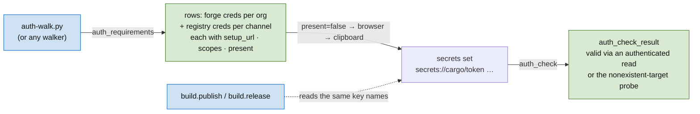

*confidence: high — every piece exists (the v4 credential catalogue, the v5 store, the forge probe idiom); the crates.io probe was verified live on 2026-09-06.*
*Ready — ratified by the owner in the request ("complete the new hyperforge ticket"), 2026-09-06. Lifecycle per ought: `Ready → active → in review → done`; the branch is recorded here when work starts.*

## Problem

`auth_requirements` answers "which credentials does hyperforge need?" only for forge tokens: one row per org × credential ref. The registry tokens the build hub resolves when it publishes — crates.io, npm, PyPI — and the one the Hackage publisher resolves are invisible to it. So `scripts/auth-walk.py` (2026-09-06), whose whole job is to collect what hyperforge needs, carries its own table of registry keys and their setup pages, checked against `secrets list_refs`. That table drifts the first time a channel is added.

The names disagree across layers too: the v4 credential specs say `crates-io/token` and a Hackage username + password; the v5 build hub resolves `cargo/token`, `npm/token`, `pypi/token`; the Hackage publisher resolves `hackage/token`; the auth-hub docs say `cargo/token`. Only the build hub's and the Hackage publisher's names are read by publish code.

## Context

- Forge rows today: `auth_requirement { org, provider, key, cred_type, present }`; `auth_check_result { org, key, provider, valid, message? }` (V5PARITY-7). `auth_check` proves a forge token by calling `repo_exists` on a repo that does not exist — a non-`auth` error means the token reached the API.
- The v4 credential catalogue carries `display_name`, `setup_url`, `instructions`, `validation`, `required_by` per key pattern. v5 does not read it.
- crates.io keeps `/api/v1/me` website-only for API tokens (403 "this action can only be performed on the crates.io website"). An authenticated yank of a crate that does not exist returns 404 "crate … does not exist" for a valid token and 403 "must be logged in" for an invalid one. Verified 2026-09-06.
- npm: `GET https://registry.npmjs.org/-/whoami` with a bearer token returns the login. Hackage: `GET /users/account-management` with `Authorization: X-ApiKey <key>` is 200 for a valid key. PyPI has no authenticated read for API tokens.

## Evidence

- The registry channels are a closed set the build hub already enumerates when it publishes (`crates.io | npm | pypi`) plus Hackage from the cabal publisher; reporting them from the same source the publish path reads guarantees the walker and the publisher agree on the key name. This is why the rows come from a catalogue keyed by the names publish code resolves, not from the v4 spec table's names.
- One name per registry: two names for one secret means a token stored under one is invisible to the code reading the other — exactly what happened on 2026-09-06 (a fresh `cargo/token` was stored; the v4 spec still asks for `crates-io/token`). The build hub's names win because they are the ones that reach `cargo publish`.
- `setup_url` and `scopes` ride on the row because the walker's only other source for them is a table in a script, which is the drift this ticket removes.
- Registry validation uses the same idiom as forge validation (an authenticated call whose non-auth failure proves the token) so `auth_check` stays one concept; crates.io forces the nonexistent-target form because its identity endpoint is website-only.

## Required behavior

| Caller | Operation | Result |
|---|---|---|
| any | `auth_requirements` | the existing forge rows, then one row per registry channel: `org: "build"`, `provider ∈ {crates.io, npm, pypi, hackage}`, `key: secrets://<canonical name>`, `cred_type: token`, `present` from the store |
| any | `auth_requirements` | every row (forge and registry) also carries `setup_url` (where a human mints the credential) and `scopes` (one line naming the permissions it needs) |
| any | `auth_requirements --channel npm` | only that registry's row (plus nothing else); `--org` keeps filtering forge rows |
| any | `auth_check` | for each registry key that is present, an `auth_check_result { org: "build", provider, key, valid, message? }` proven by an authenticated read (npm, Hackage) or the nonexistent-target probe (crates.io); PyPI reports `valid: null` with a message saying it cannot be checked |
| any | `auth_check` with a registry token that is invalid | `valid: false` with the provider's own refusal text in `message` |
| the store | any | no resolved secret value ever appears in an event |

Canonical registry key names, pinned in the v5 method reference: `cargo/token`, `npm/token`, `pypi/token`, `hackage/token`. The v4 names `crates-io/token`, `hackage/username`, `hackage/password` are no longer read anywhere; the v4 spec table either drops them or lists them as deprecated aliases that resolve to the canonical name.

## Provides (the output contract)

| Output | Shape (strong-typed) | Consumed by |
|---|---|---|
| registry rows in `auth_requirements` | `AuthRequirement { org: "build", provider: RegistryChannel, key: SecretRef, cred_type: token, present: Option<bool>, setup_url: Url, scopes: String }` | `scripts/auth-walk.py` (drops its table); any future onboarding RPC |
| `setup_url` + `scopes` on forge rows | same two fields on the existing `AuthRequirement` | `scripts/auth-walk.py` (drops its per-provider URL/scope entries) |
| registry rows in `auth_check` | `AuthCheckResult { org: "build", provider: RegistryChannel, key, valid: Option<bool>, message? }` | `auth-walk.py` post-store confirmation; `build.publish` preflight (available, no consumer yet) |
| `RegistryChannel` | closed enum `crates_io \| npm \| pypi \| hackage`, serialized `snake_case`; one canonical `SecretRef` per variant | the build hub's publish/release paths (replace their string matches) |

## Consumes (the input contract)

| Input | Shape | Produced by |
|---|---|---|
| `YamlSecretStore` / `SecretResolver` | resolve + `list_refs` | V5PARITY-7 |
| forge `auth_requirements` / `auth_check` rows | as above, unchanged | V5PARITY-7 |
| the channel → key mapping | `"crates.io" → cargo/token`, `"npm" → npm/token`, `"pypi" → pypi/token` | V5PARITY-9/10/11 (build hub) |
| `hackage/token` resolution order | env → store → cabal `password-command` | the Hackage publisher (v4, carried into v5) |
| the crates.io probe | yank of a nonexistent crate: 404 = authenticated | recorded finding, 2026-09-06 (see Context) |

## Intended Usage

**Initial design (2026-09-06):** a walker calls `auth_requirements` once, iterates rows with `present: false`, sends the human to `setup_url` with `scopes` as the instruction, stores the token with `secrets set` under the row's `key`, then calls `auth_check --key <key>` (or the whole check) and reads `valid`. The walker never carries a table of channels, URLs, scopes, or key names; if a row lacks something it needs, that is a bug in the row, not a reason to add a table. The build hub constructs its `SecretRef` from `RegistryChannel`, never from a string literal, so a renamed key cannot split the readers again.

### Divergence notes
*(append below as discovered. Do not edit prior entries.)*

## Risks

- Hackage's `X-ApiKey` header form is documented but not verified on this machine (no key present). If the account page refuses it, the check falls back to "cannot be checked" like PyPI, and the finding is appended here.
- A tier-1 test cannot reach the live registries; the probe logic is exercised against a stub HTTP server, the live form is tier 2.

## What must NOT change

- D9 secret redaction: no event carries a resolved value.
- V5PARITY-7's forge rows and their tests: same fields, same order, only two fields added.
- `build.publish` / `build.release` behavior for a stored token: same keys, same commands.
- `scripts/auth-walk.py`'s clipboard loop, validators, and cargo-login step.

## Acceptance criteria

1. On this machine's config, `auth_requirements` emits the four org rows and then four registry rows; the `cargo/token` row reads `present: true` (stored 2026-09-06), the other three `present: false`; every row carries a non-empty `setup_url` and `scopes`.
2. `auth_check` emits a `cargo/token` result with `valid: true` and no crate on crates.io is created, yanked, or changed by it.
3. `auth_check` with a deliberately wrong `cargo/token` in a scratch config dir emits `valid: false` and a message containing the provider's refusal.
4. `auth_requirements --channel hackage` emits exactly one row.
5. `scripts/auth-walk.py --dry-run` lists the same eight rows and no longer contains a table of registry keys, URLs, or scopes.
6. No code path reads `crates-io/token`, `hackage/username`, or `hackage/password`; the v5 method reference names the four canonical keys.
7. The workspace's build and test suite passes green, including the tier-1 script for this ticket.

## Completion

The tier-1 script's output, the `auth_requirements` and `auth_check` output on this machine (values redacted by construction), the branch name recorded on this ticket at `active`, and the status flip to `in review` with the change committed on that branch; the pipeline lands it to `done`.
