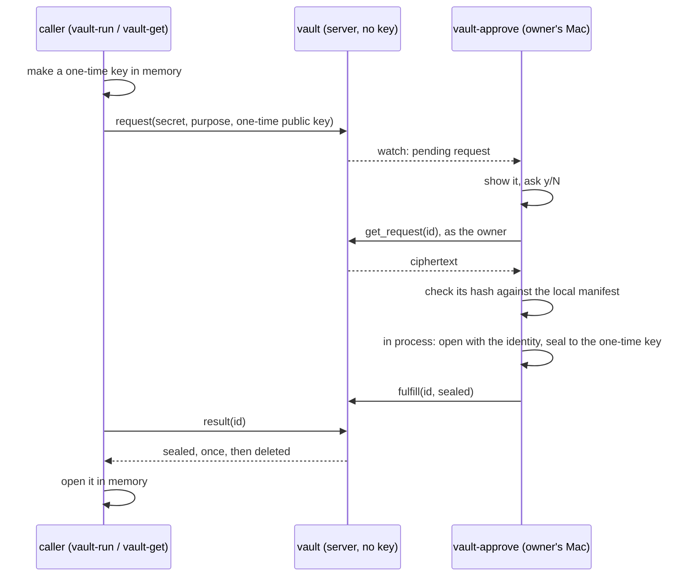

# hyperforge-vault

A secret vault whose server cannot read what it stores. The server holds only
`age` ciphertext. Each read of a secret is one request, and the only thing that
answers a request is its owner saying yes on their own machine.



On a yes, `vault-approve` opens the ciphertext and seals it to the one-time key
itself, through the `age` crate. No `age` binary or plugin runs. The plaintext
crosses one zeroized buffer in that process, and reaches no disk and no child
process. See "Inside the owner's tools" below for what that does and does not
promise. The ciphertext is ordinary age format: any age implementation opens it.

## The pieces

| Binary | Runs on | Does |
|---|---|---|
| `hyperforge-vault` | the server | Stores ciphertext, moves sealed results, writes the audit log. Has no key. |
| `vault-approve` | the owner's Mac | Watches requests, asks, checks the manifest, decrypts in process, reading the identity file at each decrypt. `--once` handles one request and exits. `recovery-keygen --out <file>` writes a recovery identity and prints its recipient. `recover <name>` opens one ciphertext with that identity, to stdout only. |
| `vault-encrypt` | the owner's Mac | Encrypts stdin to a recipients file, stores the ciphertext, records its hash in the manifest. |
| `vault-run` | the caller | Runs a command with the secret in one environment variable. |
| `vault-get` | the caller | Prints the secret to a pipe; a terminal needs `--allow-terminal`. |

Enrolling a machine and a secret: [ENROL.md](ENROL.md).

## Building

```sh
cargo build -p hyperforge-vault                        # everything
cargo build -p hyperforge-vault --no-default-features  # the client half: no server stack
```

The Mac only needs the client half, and so does anything that depends on this
crate to fetch a secret: `default-features = false` gives the `client`, `keys`,
`manifest` and `wire` modules with no plexus-core, plexus-macros or plexus-transport.

## Testing

```sh
vault/scripts/test.sh
```

Run from anywhere in the workspace, or `cargo test -p hyperforge-vault --all-features`
with `PLEXUS_NO_REGISTRY=1`. Runs real binaries over loopback and needs no `age` CLI:
the tools' `PATH` holds an `age` that records being run, and that record failing
the suite is how "nothing spawns age" is checked. Each test has a private `HOME`, a
clean environment, throwaway keys and a random canary value. The suite scans state,
logs and process memory for it.

`tests/interop.rs` checks both directions against a real age CLI, when you have one.
It is ignored by default and never fetches anything:

```sh
VAULT_AGE_CLI_DIR=/dir/holding/age PLEXUS_NO_REGISTRY=1 \
  cargo test -p hyperforge-vault --test interop -- --ignored
```

`--all-features` turns on `memory-scan-test`, which lets a test binary keep the
owner's tools dumpable so the suite can read their memory. It is for tests only:
never build a real tool with it, or with `--all-features`.

## The platform layer

`src/platform.rs` is compiled into the binaries by `#[path]` and is no part of the
library: the zeroing allocator, memory locking and core-dump settings are decisions
for a process on a desktop, and the library is what a mobile build shares. TTY
handling lives in the binaries too. `tests/platform.rs` fails if any of these reach
the library. For the same reason recovery's logic is `keys::recover`, which returns
the plaintext to its caller, and only `vault-approve` prints it.

## Keys

`src/keys.rs` is the one place that reads a key. `KeyFormat` turns a line of a
recipients or identity file into the crate's `age::Recipient` or `age::Identity`,
and `FORMATS` lists what this build reads, which today is X25519. `encrypt` and
`reseal` see only the traits, so a new key type is one more `KeyFormat`.

The crate's `plugin` feature stays off: it would run `age-plugin-*` as a child
process with the file key. So plugin and SSH recipients are refused, not skipped: a
recipients file with a line no format reads encrypts nothing. **The Secure Enclave
format is pending its spike**: see [ENROL.md](ENROL.md).

## The manifest

A local file on the owner's Mac (`--manifest`, `VAULT_MANIFEST`) mapping each
secret's name to the sha256 of its ciphertext. `vault-encrypt` writes it once the
server has taken the ciphertext. `vault-approve` reads it after a yes and before
any decrypt: a name with no entry, a hash that differs, or a manifest it cannot
read is denied with nothing decrypted, so Touch ID does not fire. It never crosses
the wire, so a server cannot speak for it. Its integrity is the integrity of the
owner's account. A secret stored without `vault-encrypt` on this machine, or
encrypted from another one, is refused until it is enrolled here.

## The owner

`get_request`, `fulfill` and `deny` are the owner's. `Store` will not run them
without an `OwnerProof`, and `owner::OwnerGate::admit` alone makes one, from the
identity the transport left on the connection. With no owner configured, it
refuses everyone: the same three methods answer nobody, and that is the default.

Today the owner is whoever holds the local credential: a random token the
approver presents as a Bearer token on the upgrade, of which the server holds only
the sha256 (`--owner-credential-hash`). The WorkOS gate replaces this with a
validated principal behind the same seam.

A method can read the identity and nothing else. Over WebSocket the hub routes
with no raw request context, so the peer address and headers never reach a method;
a check on "came from loopback" is not possible at this layer.

## The server's state

Under `--state-dir`, all owner-only:

- `secrets/<name>.age`: the ciphertexts.
- `requests/<id>.json`: one request each, replaced atomically on every change. A
  restart loses nothing.
- `audit.jsonl`: append-only: put, request, approve, deny, fulfill, deliver,
  expire. Never a value and never ciphertext.

Requests last `--request-ttl-secs` (300). A sealed result waits
`--result-ttl-secs` (60) for its one read, then goes.

## Rotating a secret

A stored secret is never replaced over the wire: an overwrite is how a device on
the network would swap a secret for a value it chose. Rotation is a deliberate
act on the server: delete `secrets/<name>.age` there, then run `vault-encrypt`
again, which replaces the manifest entry.

## What this does and does not protect

Protected: a read of the server's disk, memory or logs gives ciphertext only. The
server cannot approve for you. A sealed result opens only with the one-time key
of the caller that asked, and reads once. A server, compromised or not, cannot get
a ciphertext decrypted that the manifest does not hold for the name you approved.
A socket without the owner's credential cannot read a request's ciphertext, answer
a request or refuse one.

**Not yet protected.** These are the known gaps, in the order they will close:

- **The other methods are open to anyone who can reach the socket.** `put`,
  `list`, `request`, `pending`, `watch`, `result` and `audit` have no check. A
  device on the network can read the names, purposes and audit log, raise requests
  and store new names (which the manifest then refuses). Bind to loopback or a
  tailnet you trust until the WorkOS gate lands.
- **The local credential is one long-lived shared token.** It crosses the socket
  on every approver connection, in the clear on `ws://`, so bind only to loopback
  or a tailnet, whose encryption is what protects it. Anyone who has it is the
  owner on the server, though never able to decrypt.
- **A compromised server can still mislead a caller**, by answering `result`
  itself with anything sealed to the caller's one-time key. The owner gate holds
  against other sockets, not against the server. A caller has nothing that
  authenticates the sealed result.
- **`purpose` and `caller` are the caller's own words.** The prompt says so.
  Nothing verifies them.

Limits that will stay:

- **Inside the owner's tools.** `vault-encrypt` and `vault-approve` hold the value
  in their own memory while they work, which the `age` CLI used to do for them.
  Anything that can read this process's memory during that time can read it. See
  below for what shortens that time and what does not.
- **Same user.** `vault-run` puts the value in the command's environment, where
  another process of the same user can read it from `/proc`. Run what you do not
  trust as a different user.
- **`PLEXUS_WS_TRACE` is a debug tool.** It prints raw frames, so caller-written
  text reaches your terminal unsanitised. Never set it on a real approver.

### Memory in the owner's tools

`vault-approve`, including `recover`, and `vault-encrypt` run on a heap that wipes
every block as it is freed, including the `Vec`s inside the `age` crate that no
`Zeroizing` reaches, and that locks every heap block out of swap. Core dumps are
off: `RLIMIT_CORE` is 0, and on Linux the process is also undumpable, since the
limit does not bind a core piped to a handler such as systemd-coredump. That also
closes `/proc/<pid>/mem` and ptrace to this user's other processes.

If memory cannot be locked the tool says so on stderr and goes on. With
`--require-memory-lock` it stops instead, before any value at startup, and sends no
seal if a block fails to lock later. `mlockall` is not used: it does not exist on
macOS, and on Linux it can make a thread's stack fail to map under a low limit.

Measured: the suite's canary is gone from both tools 300 ms after each of three
releases, at two value sizes, where before it stayed. That is the test, not a proof
of absence.

**Not covered:**

- **Stack copies.** Stack frames are neither wiped nor locked. The scan finds none,
  but nothing prevents one, and a finished thread's stack can be reused unwiped.
- **While the value is in use.** A live value is plaintext in memory until freed.
  On macOS these tools are not undumpable, so what stops a same-user debugger there
  is the system's own policy, not this code.
- **The terminal.** Its scrollback, under `--allow-terminal`, is the terminal's.
- **Kernel buffers.** The pipe into `vault-encrypt` or out of `recover`.
- **The caller's copy after a release.** `vault-get` and `vault-run` have neither the
  heap nor the locking, only `RLIMIT_CORE`, and `vault-run` hands the value to a
  child's environment. Wiping the approver does nothing for those.
- **Hibernation.** A locked page is still written to the hibernation image, under
  full-disk encryption if it is on.
- **The window at startup.** Blocks allocated before `lock_heap` runs are wiped but
  not locked. Nothing secret exists by then.
- **The allocator's bookkeeping.** Bytes outside a block's requested size are not
  ours to wipe, and `recover`'s stdout, or any other process, is outside it.

## Licence

MIT.
