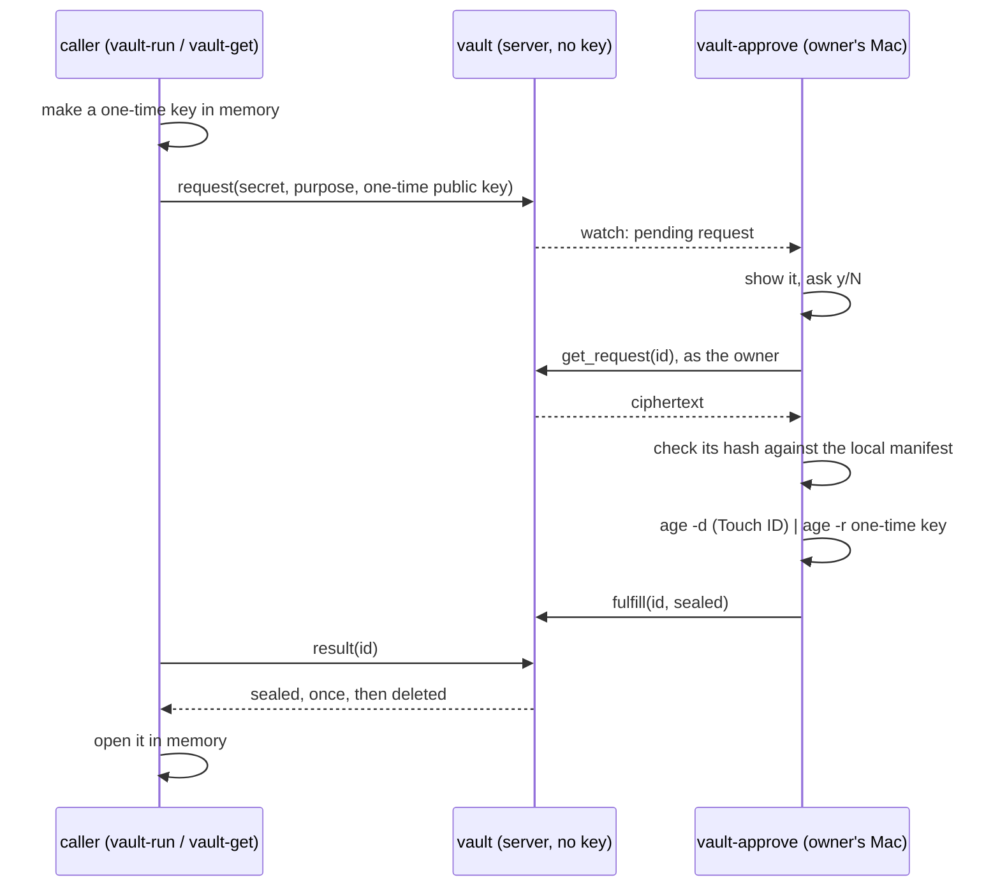

# hyperforge-vault

A secret vault whose server cannot read what it stores. The server holds only
`age` ciphertext. Each read of a secret is one request, and the only thing that
answers a request is its owner saying yes on their own machine.



On a yes, `age -d` pipes straight into `age -r`: the plaintext crosses one OS pipe
between two `age` processes and never enters `vault-approve`.

## The pieces

| Binary | Runs on | Does |
|---|---|---|
| `hyperforge-vault` | the server | Stores ciphertext, moves sealed results, writes the audit log. Has no key. |
| `vault-approve` | the owner's Mac | Watches requests, asks, checks the manifest, decrypts through `age` so Touch ID fires. `--once` handles one request and exits. |
| `vault-encrypt` | the owner's Mac | Encrypts stdin to a recipients file, stores the ciphertext, records its hash in the manifest. |
| `vault-run` | the caller | Runs a command with the secret in one environment variable. |
| `vault-get` | the caller | Prints the secret to a pipe; a terminal needs `--allow-terminal`. |

Enrolling a machine and a secret: [ENROL.md](ENROL.md).

## Building

```sh
cargo build -p hyperforge-vault                        # everything
cargo build -p hyperforge-vault --no-default-features  # the client half: no server stack
```

The Mac only needs the client half, and so does anything that depends on this
crate to fetch a secret: `default-features = false` gives the `client` and `wire`
modules with no plexus-core, plexus-macros or plexus-transport.

## Testing

```sh
vault/scripts/test.sh
```

Run from anywhere in the workspace. `cargo test -p hyperforge-vault --all-features`
also works once `scripts/fetch-age.sh` has run. Runs real binaries over loopback against the real `age` CLI, which
`scripts/fetch-age.sh` puts in the gitignored `.tools/` at a pinned version and
checksum. Each test has a private `HOME`, a clean environment, throwaway keys and
a random canary value. The suite scans state, logs and process memory for it.

## The manifest

A local file on the owner's Mac (`--manifest`, `VAULT_MANIFEST`) mapping each
secret's name to the sha256 of its ciphertext. `vault-encrypt` writes it once the
server has taken the ciphertext. `vault-approve` reads it after a yes and before
any decrypt: a name with no entry, a hash that differs, or a manifest it cannot
read is denied with nothing decrypted, so Touch ID does not fire. It never crosses
the wire, so a server cannot speak for it. Its integrity is the integrity of the
owner's account. A secret stored without `vault-encrypt` on this machine, or
encrypted from another one, is refused until it is enrolled here.

## The owner

`get_request`, `fulfill` and `deny` are the owner's. `Store` will not run them
without an `OwnerProof`, and `owner::OwnerGate::admit` alone makes one, from the
identity the transport left on the connection. With no owner configured, it
refuses everyone: the same three methods answer nobody, and that is the default.

Today the owner is whoever holds the local credential: a random token the
approver presents as a Bearer token on the upgrade, of which the server holds only
the sha256 (`--owner-credential-hash`). The WorkOS gate replaces this with a
validated principal behind the same seam.

A method can read the identity and nothing else. Over WebSocket the hub routes
with no raw request context, so the peer address and headers never reach a method;
a check on "came from loopback" is not possible at this layer.

## The server's state

Under `--state-dir`, all owner-only:

- `secrets/<name>.age`: the ciphertexts.
- `requests/<id>.json`: one request each, replaced atomically on every change. A
  restart loses nothing.
- `audit.jsonl`: append-only: put, request, approve, deny, fulfill, deliver,
  expire. Never a value and never ciphertext.

Requests last `--request-ttl-secs` (300). A sealed result waits
`--result-ttl-secs` (60) for its one read, then goes.

## Rotating a secret

A stored secret is never replaced over the wire: an overwrite is how a device on
the network would swap a secret for a value it chose. Rotation is a deliberate
act on the server: delete `secrets/<name>.age` there, then run `vault-encrypt`
again, which replaces the manifest entry.

## What this does and does not protect

Protected: a read of the server's disk, memory or logs gives ciphertext only. The
server cannot approve for you. A sealed result opens only with the one-time key
of the caller that asked, and reads once. A server, compromised or not, cannot get
a ciphertext decrypted that the manifest does not hold for the name you approved.
A socket without the owner's credential cannot read a request's ciphertext, answer
a request or refuse one.

**Not yet protected.** These are the known gaps, in the order they will close:

- **The other methods are open to anyone who can reach the socket.** `put`,
  `list`, `request`, `pending`, `watch`, `result` and `audit` have no check. A
  device on the network can read the names, purposes and audit log, raise requests
  and store new names (which the manifest then refuses). Bind to loopback or a
  tailnet you trust until the WorkOS gate lands.
- **The local credential is one long-lived shared token.** It crosses the socket
  on every approver connection, in the clear on `ws://`, so bind only to loopback
  or a tailnet, whose encryption is what protects it. Anyone who has it is the
  owner on the server, though never able to decrypt.
- **A compromised server can still mislead a caller**, by answering `result`
  itself with anything sealed to the caller's one-time key. The owner gate holds
  against other sockets, not against the server. A caller has nothing that
  authenticates the sealed result.
- **`purpose` and `caller` are the caller's own words.** The prompt says so.
  Nothing verifies them.

Limits that will stay:

- **Same user.** `vault-run` puts the value in the command's environment, where
  another process of the same user can read it from `/proc`. Run what you do not
  trust as a different user.
- **`PLEXUS_WS_TRACE` is a debug tool.** It prints raw frames, so caller-written
  text reaches your terminal unsanitised. Never set it on a real approver.

## Licence

MIT.
