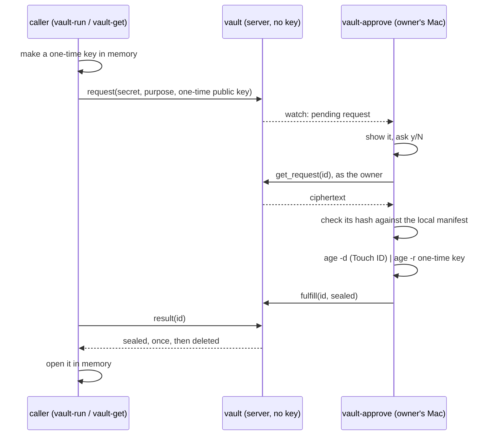

# hyperforge-vault

A secret vault whose server cannot read what it stores. The server holds only
`age` ciphertext. Each read of a secret is one request, and the only thing that
answers a request is its owner saying yes on their own machine.



On a yes, `age -d` pipes straight into `age -r`: the plaintext crosses one OS pipe
between two `age` processes and never enters `vault-approve`.

## The pieces

| Binary | Runs on | Does |
|---|---|---|
| `hyperforge-vault` | the server | Stores ciphertext, moves sealed results, writes the audit log. Has no key. |
| `vault-approve` | the owner's Mac | Watches requests, asks, checks the manifest, decrypts through `age` so Touch ID fires. `--once` handles one request and exits. |
| `vault-login` | the owner's Mac | Signs the owner in to WorkOS (PKCE, no secret) and keeps the tokens for the two tools around it. |
| `vault-encrypt` | the owner's Mac | Encrypts stdin to a recipients file, stores the ciphertext, records its hash in the manifest. |
| `vault-run` | the caller | Runs a command with the secret in one environment variable. |
| `vault-get` | the caller | Prints the secret to a pipe; a terminal needs `--allow-terminal`. |

Enrolling a machine and a secret: [ENROL.md](ENROL.md).

## Building

```sh
cargo build -p hyperforge-vault                        # everything
cargo build -p hyperforge-vault --no-default-features  # the client half: no server stack
```

The Mac only needs the client half, and so does anything that depends on this
crate to fetch a secret: `default-features = false` gives the `client` and `wire`
modules with no plexus-core, plexus-macros or plexus-transport.

## Testing

```sh
vault/scripts/test.sh
```

Run from anywhere in the workspace. `cargo test -p hyperforge-vault --all-features`
also works once `scripts/fetch-age.sh` has run. Runs real binaries over loopback against the real `age` CLI, which
`scripts/fetch-age.sh` puts in the gitignored `.tools/` at a pinned version and
checksum. Each test has a private `HOME`, a clean environment, throwaway keys and
a random canary value. The suite scans state, logs and process memory for it.

## The manifest

A local file on the owner's Mac (`--manifest`, `VAULT_MANIFEST`) mapping each
secret's name to the sha256 of its ciphertext. `vault-encrypt` writes it once the
server has taken the ciphertext. `vault-approve` reads it after a yes and before
any decrypt: a name with no entry, a hash that differs, or a manifest it cannot
read is denied with nothing decrypted, so Touch ID does not fire. It never crosses
the wire, so a server cannot speak for it. Its integrity is the integrity of the
owner's account. A secret stored without `vault-encrypt` on this machine, or
encrypted from another one, is refused until it is enrolled here.

## The gate

Every method is gated. Two checks, kept apart:

- **The door.** The transport asks `owner::VaultValidator` who a socket is, on the
  upgrade, and a socket with no answer gets a 401. It admits the owner's WorkOS token
  and a known machine's credential, and nobody else: no token, a bad signature, another
  client or issuer, an expired token. A valid token for another user is refused too,
  because Menger's WorkOS client is shared: a good token proves only that someone is a
  Menger user.
- **The gate.** Each method then asks `owner::OwnerGate`. `Store` will not run without
  the `OwnerProof` or `Requester` that only the gate makes, so skipping it does not
  compile. With no owner configured it refuses everyone, machines too, and that is the
  default.

| Method | Owner | Machine |
|---|---|---|
| `request` | yes | yes |
| `result` | any request | its own requests; anyone else's reads as no such request |
| `put`, `list`, `pending`, `watch`, `get_request`, `fulfill`, `deny`, `audit` | yes | no |

A method can read the identity and nothing else. Over WebSocket the hub routes with no
raw request context, so the peer address and headers never reach a method; a check on
"came from loopback" is not possible at this layer. That is why machines hold a
credential: a random token, of which the server holds only the sha256.

**The owner's token.** `vault-login` signs in as a public client with PKCE; there is no
secret on this side. synapse's login cannot be reused: it stores an opaque Menger session,
which WorkOS's issuer did not sign. Access tokens are short-lived, and a socket closes when
its token ends. The approver refreshes on each reconnect and answers each request on a
connection of its own, so an answer given while the socket closed is not lost. `--once`
exits non-zero instead of reconnecting.

**The bind.** Tokens cross the socket as `ws://`, so the network has to protect them. The
service refuses to bind anything but loopback or a tailnet address (100.64.0.0/10,
fd7a:115c:a1e0::/48) without `--allow-unsafe-bind`. 100.64.0.0/10 is also carrier-grade NAT
space, so this says the address could be a tailnet's, not that it is.

## The server's state

Under `--state-dir`, all owner-only:

- `secrets/<name>.age`: the ciphertexts.
- `requests/<id>.json`: one request each, replaced atomically on every change. A
  restart loses nothing.
- `audit.jsonl`: append-only: put, request, approve, deny, fulfill, deliver,
  expire. Never a value and never ciphertext.

Requests last `--request-ttl-secs` (300). A sealed result waits
`--result-ttl-secs` (60) for its one read, then goes.

## Rotating a secret

A stored secret is never replaced over the wire: an overwrite is how a device on
the network would swap a secret for a value it chose. Rotation is a deliberate
act on the server: delete `secrets/<name>.age` there, then run `vault-encrypt`
again, which replaces the manifest entry.

## What this does and does not protect

Protected: a read of the server's disk, memory or logs gives ciphertext only. The
server cannot approve for you. A sealed result opens only with the one-time key
of the caller that asked, and reads once. A server, compromised or not, cannot get
a ciphertext decrypted that the manifest does not hold for the name you approved.
A socket without the owner's token or a machine's credential reaches nothing at all.

**Not yet protected.** These are the known gaps, in the order they will close:

- **A machine credential does not expire.** It lasts until its line leaves
  `--machine-credentials` and the server restarts. A stolen one can raise requests,
  which the owner still has to approve.
- **A compromised server can still mislead a caller**, by answering `result`
  itself with anything sealed to the caller's one-time key. The owner gate holds
  against other sockets, not against the server. A caller has nothing that
  authenticates the sealed result.
- **`purpose` and `caller` are the caller's own words.** The prompt says so.
  The server knows which machine asked and uses that for `result`, but neither the
  prompt nor the audit log shows it yet.
- **`login.json` holds a refresh token** in a 0600 file on the Mac. Two tools refreshing
  in the same instant can race on it, since WorkOS's refresh tokens rotate; `vault-login`
  recovers.

Limits that will stay:

- **Same user.** `vault-run` puts the value in the command's environment, where
  another process of the same user can read it from `/proc`. Run what you do not
  trust as a different user.
- **`PLEXUS_WS_TRACE` is a debug tool.** It prints raw frames, so caller-written
  text reaches your terminal unsanitised. Never set it on a real approver.

## Licence

MIT.
